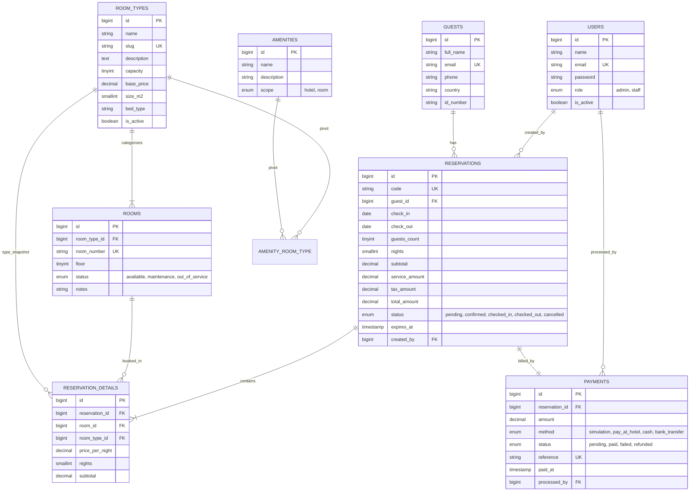
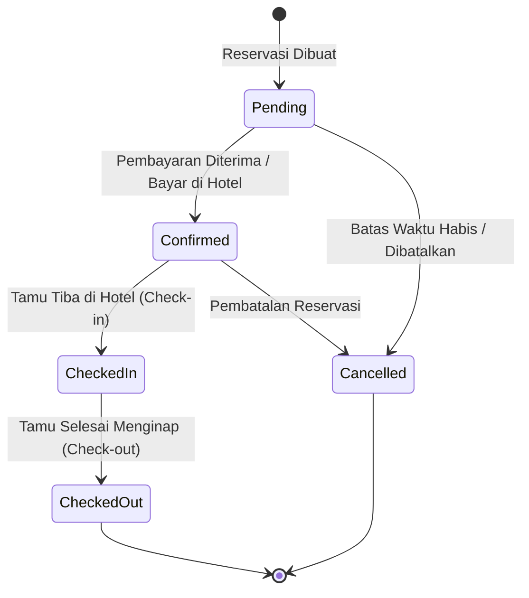

# 🏨 THE EAST HOTEL – BUKU PANDUAN & DOKUMENTASI TEKNIS MASTER

> **Status Sistem:** Siap Produksi (Production Ready)  
> **Framework:** Laravel 11 (PHP 8.2+)  
> **Arsitektur:** REST API Backend + Server-Side Admin Panel (Blade Template)  
> **Database:** Dual Engine Support (SQLite File-based & MySQL XAMPP Relational)  
> **Autentikasi:** Laravel Session Guard (Web Panel) & Laravel Sanctum Bearer Token (REST API)

---

## 📑 DAFTAR ISI UTAMA
1. [Kredensial Akun & Hak Akses (RBAC)](#1-kredensial-akun--hak-akses-rbac)
2. [Investigasi Mendalam: Kenapa Data Web Tidak Masuk ke phpMyAdmin MySQL?](#2-investigasi-mendalam-kenapa-data-web-tidak-masuk-ke-phpmyadmin-mysql)
3. [Panduan Konfigurasi & Migrasi Database (SQLite vs MySQL)](#3-panduan-konfigurasi--migrasi-database-sqlite-vs-mysql)
4. [Diagram Relasi Database (Entity Relationship Diagram - ERD)](#4-diagram-relasi-database-entity-relationship-diagram---erd)
5. [Kamus Data Lengkap (Data Dictionary & Schema)](#5-kamus-data-lengkap-data-dictionary--schema)
6. [Arsitektur Request Lifecycle & Keamanan](#6-arsitektur-request-lifecycle--keamanan)
7. [Bedah Logika Bisnis & Mesin CRUD Otomatis](#7-bedah-logika-bisnis--mesin-crud-otomatis)
   - [A. Logika Sinkronisasi Status Kamar Dinamis (Tersedia vs Penuh)](#a-logika-sinkronisasi-status-kamar-dinamis-tersedia-vs-penuh)
   - [B. Mesin Anti Double-Booking & Kunci Konkurensi](#b-mesin-anti-double-booking--kunci-konkurensi)
   - [C. Rumus Finansial Perhitungan Tarif (Service & PPN)](#c-rumus-finansial-perhitungan-tarif-service--ppn)
   - [D. Diagram Transisi Status Reservasi & Pembayaran (State Machine)](#d-diagram-transisi-status-reservasi--pembayaran-state-machine)
   - [E. Pembersihan Bersih Data Terhapus (Cascade & Soft Deletes)](#e-pembersihan-bersih-data-terhapus-cascade--soft-deletes)
8. [Katalog Endpoint RESTful API (v1)](#8-katalog-endpoint-restful-api-v1)
9. [Matriks Pemecahan Masalah (Troubleshooting Matrix)](#9-matriks-pemecahan-masalah-troubleshooting-matrix)

---

## 1. Kredensial Akun & Hak Akses (RBAC)

Aplikasi menerapkan sistem otentikasi berbasis peran (*Role-Based Access Control* - RBAC) yang terbagi menjadi dua level pengguna:

| Peran | Email | Kata Sandi | Batasan Hak Akses |
|---|---|---|---|
| **Admin** | `admin@theeasthotel.test` | `password123` | **Full Access:** CRUD Kamar, Tipe Kamar, Fasilitas, Pengguna Sistem, Tamu, Reservasi, dan Pembayaran |
| **Staff** | `staf@theeasthotel.test` | `password123` | **Operational Access:** Membuat/mengelola Reservasi, memproses Pembayaran, melihat/mengedit data Tamu, melihat ketersediaan Kamar (dilarang menghapus master data kamar dan akun pengguna) |

* **URL Login Web:** [http://127.0.0.1:8000/admin/login](http://127.0.0.1:8000/admin/login)
* **API Login Endpoint:** `POST http://127.0.0.1:8000/api/v1/auth/login`

---

## 2. Investigasi Mendalam: Kenapa Data Web Tidak Masuk ke phpMyAdmin MySQL?

Banyak developer pemula bingung ketika data yang diinput dari web bisa tersimpan rapi, namun saat membuka phpMyAdmin MySQL, tabelnya tetap kosong.

### 🔬 Akar Masalah Teknis:
Kunci utama terletak pada file **`.env`** di baris 23–24:
```dotenv
DB_CONNECTION=sqlite
DB_DATABASE=C:/the-east-hotel-api/database/database.sqlite
```

1. **Dua Mesin Database Berjalan Terpisah di Komputer Anda:**
   * **Database 1: SQLite (`database/database.sqlite`)**  
     Database ini merupakan **file biner mandiri** di dalam folder proyek Anda. SQLite dijalankan langsung oleh pustaka PHP internal tanpa memerlukan port jaringan, tanpa user, dan tanpa password.
   * **Database 2: MySQL XAMPP (Port 3306)**  
     Database ini berupa **server daemon terpisah** (`mysqld.exe`) yang dikelola oleh XAMPP Control Panel. phpMyAdmin (`http://localhost/phpmyadmin`) adalah aplikasi web PHP yang **hanya membaca dan menampilkan data dari server MySQL XAMPP**.
2. **Bagaimana Laravel Memilih Database?**
   * Laravel **tidak pernah menebak** database mana yang harus diisi. Laravel membaca variabel `DB_CONNECTION` pada file `.env`.
   * Saat `DB_CONNECTION=sqlite`, seluruh perintah ORM (`Room::create()`, `Reservation::save()`, dsb.) akan mengalirkan query SQL ke file `database/database.sqlite`.
   * Akibatnya: Data Anda **100% tersimpan aman**, namun berada di dalam file SQLite, sehingga wajar jika phpMyAdmin MySQL tidak menampilkannya karena phpMyAdmin tidak membaca file SQLite tersebut.

---

## 3. Panduan Konfigurasi & Migrasi Database (SQLite vs MySQL)

Anda bebas memilih database mana yang ingin digunakan:

### Cara A: Menghubungkan Web ke phpMyAdmin MySQL XAMPP
Jika Anda ingin seluruh data web tersinkron langsung ke tabel phpMyAdmin:
1. Pastikan modul **Apache** dan **MySQL** di **XAMPP Control Panel** berstatus **Running (Hijau)**.
2. Buka file `.env`, sesuaikan nilai konfigurasi:
   ```dotenv
   DB_CONNECTION=mysql
   DB_HOST=127.0.0.1
   DB_PORT=3306
   DB_DATABASE=the_east_hotel
   DB_USERNAME=root
   DB_PASSWORD=
   ```
3. Bersihkan cache konfigurasi Laravel:
   ```powershell
   php artisan config:clear
   ```
4. Jalankan migrasi dan seeder awal:
   ```powershell
   php artisan migrate:fresh --seed
   ```
   *(Atau impor file `public/the_east_hotel.sql` langsung melalui tab Import di phpMyAdmin).*

### Cara B: Menggunakan SQLite (Portabel & Cepat Tanpa XAMPP)
Jika tidak ingin repot menyalakan XAMPP setiap saat:
```dotenv
DB_CONNECTION=sqlite
DB_DATABASE=C:/the-east-hotel-api/database/database.sqlite
```
Setelah mengubah `.env`, selalu jalankan `php artisan config:clear`.

---

## 4. Diagram Relasi Database (Entity Relationship Diagram - ERD)

Aplikasi dibangun di atas skema relasional terstandarisasi untuk mencegah redundansi dan anomali data:



---

## 5. Kamus Data Lengkap (Data Dictionary & Schema)

### 1. Tabel `users`
Menyimpan kredensial autentikasi staf dan administrator hotel.
* `id` (BIGINT UNSIGNED, PK, Auto Increment)
* `name` (VARCHAR 255): Nama lengkap pengguna.
* `email` (VARCHAR 255, Unique): Alamat email untuk login.
* `password` (VARCHAR 255): Hash Bcrypt kata sandi pengguna.
* `role` (ENUM: `'admin'`, `'staff'`): Tingkat wewenang akun.
* `is_active` (BOOLEAN): Status keaktifan akun (1 = aktif, 0 = dinonaktifkan).

### 2. Tabel `room_types`
Menyimpan kategori/varian tipe kamar hotel.
* `id` (BIGINT UNSIGNED, PK, Auto Increment)
* `name` (VARCHAR 100): Nama tipe kamar (contoh: *Deluxe Garden*).
* `slug` (VARCHAR 120, Unique): Slug ramah URL (contoh: *deluxe-garden*).
* `capacity` (TINYINT UNSIGNED): Kapasitas maksimal tamu dewasa.
* `base_price` (DECIMAL 12,2): Tarif dasar sewa per malam (dalam Rupiah).
* `size_m2` (SMALLINT UNSIGNED, Nullable): Luas kamar dalam meter persegi.
* `bed_type` (VARCHAR 60): Konfigurasi ranjang (contoh: *1 King Bed*).
* `deleted_at` (TIMESTAMP, Nullable): Penanda waktu soft-delete.

### 3. Tabel `rooms`
Menyimpan unit kamar fisik nyata di properti hotel.
* `id` (BIGINT UNSIGNED, PK, Auto Increment)
* `room_type_id` (BIGINT UNSIGNED, FK -> `room_types.id`): Tipe varian kamar.
* `room_number` (VARCHAR 10, Unique): Nomor fisik pintu kamar (contoh: *101*, *V1*).
* `floor` (TINYINT UNSIGNED): Nomor lantai (0 = Ground Floor / Lantai Dasar).
* `status` (ENUM: `'available'`, `'maintenance'`, `'out_of_service'`): Status fisik kamar.

### 4. Tabel `reservations`
Menyimpan data transaksi pemesanan hotel.
* `id` (BIGINT UNSIGNED, PK, Auto Increment)
* `code` (VARCHAR 12, Unique): Kode alfanumerik unik reservasi (format: `TEH-XXXXXX`).
* `guest_id` (BIGINT UNSIGNED, FK -> `guests.id`): Data profil tamu penyewa.
* `check_in` (DATE): Tanggal mulai menginap (pukul 14:00 waktu lokal).
* `check_out` (DATE): Tanggal keluar (pukul 12:00 waktu lokal).
* `nights` (SMALLINT UNSIGNED): Durasi jumlah malam menginap.
* `subtotal` (DECIMAL 12,2): Total biaya sewa kamar murni.
* `service_amount` (DECIMAL 12,2): Biaya layanan hotel (10% dari subtotal).
* `tax_amount` (DECIMAL 12,2): Pajak pertambahan nilai (11% dari subtotal + layanan).
* `total_amount` (DECIMAL 12,2): Total tagihan akhir wajib bayar.
* `status` (ENUM: `'pending'`, `'confirmed'`, `'checked_in'`, `'checked_out'`, `'cancelled'`).
* `expires_at` (TIMESTAMP, Nullable): Batas waktu toleransi pembayaran pending.

---

## 6. Arsitektur Request Lifecycle & Keamanan

Setiap request HTTP yang dikirimkan oleh klien melewati lapisan filter keamanan bertingkat:

```
[Browser / Klien REST]
       │
       ▼ (Permintaan HTTP)
1. Web Server / PHP Built-in Server
       │
       ▼ (bootstrap/app.php)
2. Laravel Global Middleware:
   - HandleCors
   - PreventRequestsDuringMaintenance
   - ValidatePostSize
   - TrimStrings & ConvertEmptyStringsToNull
       │
       ▼ (Routing Layer: routes/web.php atau routes/api.php)
3. Route-Specific Middleware:
   - 'auth' atau 'auth:sanctum' -> Autentikasi sesi / token
   - 'role:admin' / 'role:admin,staff' -> Pemeriksaan otorisasi peran
   - 'throttle' -> Proteksi brute-force & spamming request
       │
       ▼ (Controller & Form Request Validation)
4. Admin Controllers:
   - Validasi input ketat (mencegah SQL Injection & XSS)
   - Panggilan Layanan Transaksi Database (DB::transaction)
       │
       ▼ (Presentation Layer)
5. View Compilation:
   - Blade Template Rendering
   - Sanitasi keluaran via escaping otomatis {{ $variabel }}
```

---

## 7. Bedah Logika Bisnis & Mesin CRUD Otomatis

### A. Logika Sinkronisasi Status Kamar Dinamis (Tersedia vs Penuh)
Di hotel operasional nyata, kamar tidak boleh hanya mengandalkan status statis dari tabel `rooms`. Jika hari ini ada tamu menginap, kamar wajib otomatis ditandai **Penuh**, dan saat tamu check-out kembali menjadi **Tersedia**.

#### 🧠 Implementasi Algoritma (`app/Http/Controllers/Admin/AdminRoomController.php`):
Ketika halaman daftar kamar dibuka, controller menjalankan query sinkronisasi terhadap tanggal hari ini:
```php
$today = today()->toDateString(); // Tanggal berjalan sistem (Y-m-d)

// Deteksi seluruh kamar yang sedang terikat reservasi aktif hari ini
$activeReservations = DB::table('reservation_details as d')
    ->join('reservations as r', 'r.id', '=', 'd.reservation_id')
    ->join('guests as g', 'g.id', '=', 'r.guest_id')
    ->whereIn('r.status', ['confirmed', 'checked_in'])
    ->where('r.check_in', '<=', $today)  // Tamu sudah/sedang check-in
    ->where('r.check_out', '>', $today)  // Tamu belum saatnya check-out
    ->select('d.room_id', 'r.id as reservation_id', 'r.code', 'g.full_name as guest_name')
    ->get()
    ->keyBy('room_id');
```

#### 🎨 Aturan Evaluasi di Blade (`resources/views/admin/rooms/index.blade.php`):
1. **Perbaikan (`maintenance`):** Jika status fisik kamar memang diset dalam perbaikan teknis.
2. **Tidak Aktif (`out_of_service`):** Jika kamar sengaja dimatikan dari inventori.
3. **Penuh (Occupied):** Jika ID kamar ditemukan di dalam daftar `$activeReservations`. Sistem langsung mencetak badge merah dan menautkan nama tamu serta kode reservasi aktifnya.
4. **Tersedia (Available):** Jika kamar operasional dan tidak ada tamu yang menempati kamar hari ini.

---

### B. Mesin Anti Double-Booking & Kunci Konkurensi
* **File:** `app/Services/ReservationService.php`

#### 1. Teorema Tumpang-Tindih Tanggal (Date Overlap Detection):
Dua periode menginap $[A_{in}, A_{out}]$ dan $[B_{in}, B_{out}]$ dikatakan **bertabrakan** jika dan hanya jika:
$$\text{Existing Check-in} < \text{New Check-out} \quad \text{DAN} \quad \text{Existing Check-out} > \text{New Check-in}$$
*(Ketentuan: Tanggal check-out tamu A yang bertepatan dengan tanggal check-in tamu B pada hari yang sama TIDAK dianggap bertabrakan).*

#### 2. Kunci Baris Transaksi (Pessimistic Locking):
Untuk mencegah kondisi *race-condition* saat dua pemesan menekan tombol pesan pada detik yang bersamaan:
```php
return DB::transaction(function () use ($data, $userId) {
    // 1. Kunci baris seluruh unit kamar tipe bersangkutan
    $rooms = Room::where('room_type_id', $data['room_type_id'])
        ->where('status', 'available')
        ->lockForUpdate() // Transaksi lain wajib mengantre (WAIT)
        ->get();

    // 2. Filter kamar yang benar-benar bebas dari reservasi bertabrakan
    $booked = $this->bookedRoomIds($data['check_in'], $data['check_out'], true);
    $free = $rooms->reject(fn ($r) => in_array($r->id, $booked));

    $room = $free->first();
    if (! $room) {
        throw ValidationException::withMessages([
            'room_type_id' => 'Maaf, kamar untuk tanggal tersebut baru saja terisi.'
        ]);
    }

    // 3. Simpan reservasi dan alokasikan kamar secara permanen
    ...
}, 3); // Coba ulang hingga 3 kali jika terjadi deadlock
```

---

### C. Rumus Finansial Perhitungan Tarif (Service & PPN)
Penghitungan tagihan dihitung secara eksklusif di backend berdasarkan konfigurasi pada `config/hotel.php`:
* **Tarif Layanan (Service Rate):** $10\%$
* **Tarif Pajak Pertambahan Nilai (Tax Rate):** $11\%$

$$\text{Subtotal} = \text{Harga Dasar per Malam} \times \text{Jumlah Malam}$$
$$\text{Service Amount} = \text{Round}(\text{Subtotal} \times 0.10)$$
$$\text{Tax Amount} = \text{Round}((\text{Subtotal} + \text{Service Amount}) \times 0.11)$$
$$\text{Total Amount} = \text{Subtotal} + \text{Service Amount} + \text{Tax Amount}$$

---

### D. Diagram Transisi Status Reservasi & Pembayaran (State Machine)

Status reservasi dan pembayaran tunduk pada mesin transisi ketat (`Reservation::TRANSITIONS` & `Payment::TRANSITIONS`):



---

### E. Pembersihan Bersih Data Terhapus (Cascade & Soft Deletes)

#### 1. Penghapusan Reservasi Bersih (Cascade Delete):
Tabel `reservation_details` dan `payments` memiliki integritas referensial foreign key `ON DELETE RESTRICT`. Saat tombol **Hapus** ditekan di admin panel:
```php
public function destroy(Reservation $reservation)
{
    DB::transaction(function () use ($reservation) {
        $reservation->details()->delete(); // Hapus rincian pemesanan kamar
        $reservation->payment()->delete(); // Hapus catatan transaksi pembayaran
        $reservation->delete();            // Hapus data induk reservasi
    });

    return redirect()->route('admin.reservations.index')
        ->with('success', "Reservasi {$reservation->code} berhasil dihapus.");
}
```

#### 2. Eliminasi Kartu "Dihapus" pada Tipe Kamar:
* Di masa awal, query menggunakan `RoomType::withTrashed()`, yang sengaja memuat kamar yang berstatus soft-delete (`deleted_at IS NOT NULL`).
* Sekarang query telah disederhanakan menjadi `RoomType::with(...)`, sehingga data yang berstatus dihapus **otomatis tereliminasi dari query database** dan antarmuka web tetap bersih.

---

## 8. Katalog Endpoint RESTful API (v1)

Aplikasi menyediakan API standar industri untuk diintegrasikan dengan aplikasi mobile atau sistem eksternal:

### Endpoint Publik (Tanpa Token):
* `GET  /api/v1/room-types` : Mengambil seluruh varian tipe kamar beserta fasilitas dan harga.
* `GET  /api/v1/room-types/{slug}` : Mengambil detail tipe kamar tertentu beserta ketersediaannya.
* `GET  /api/v1/amenities` : Daftar fasilitas umum hotel dan fasilitas kamar.
* `POST /api/v1/reservations` : Tamu membuat reservasi baru mandiri secara online.
* `GET  /api/v1/reservations/lookup?code=TEH-XXXXXX` : Tamu melacak status reservasi menggunakan kode booking.
* `POST /api/v1/reservations/{code}/payments` : Simulasi penyelesaian pembayaran online.
* `POST /api/v1/auth/login` : Login untuk mendapatkan Bearer Token Sanctum.

### Endpoint Terproteksi (Header: `Authorization: Bearer <TOKEN>`):
* `GET   /api/v1/auth/me` : Informasi profil pengguna yang sedang login.
* `POST  /api/v1/auth/logout` : Revokasi token sesi aktif.
* `GET   /api/v1/admin/dashboard` : Statistik okupansi, pendapatan bulanan, dan jadwal check-in/out hari ini.
* `GET   /api/v1/admin/reservations` : Daftar seluruh reservasi dengan filter pencarian tanggal dan status.
* `PATCH /api/v1/admin/reservations/{id}/status` : Memperbarui status reservasi (*checked_in*, *checked_out*, dsb.).
* `PATCH /api/v1/admin/payments/{id}` : Konfirmasi penerimaan pembayaran manual.
* `apiResource /api/v1/admin/room-types` : Endpoint CRUD master tipe kamar (khusus Admin).
* `apiResource /api/v1/admin/rooms` : Endpoint CRUD nomor unit fisik kamar (khusus Admin).

---

## 9. Matriks Pemecahan Masalah (Troubleshooting Matrix)

| Gejala Masalah | Penyebab Teknis | Solusi Definitif |
|---|---|---|
| **Data tidak muncul di phpMyAdmin** | File `.env` masih mengarah ke driver `sqlite`. | Ubah `.env` ke `DB_CONNECTION=mysql`, lalu jalankan `php artisan config:clear`. |
| **SQLSTATE[HY000] [2002] Socket forbidden / refused** | Layanan MySQL di XAMPP belum aktif atau port 3306 diblokir. | Buka XAMPP Control Panel dan klik tombol **Start** pada modul **MySQL**. |
| **Error 419 (Page Expired)** | Token CSRF pada form sesi telah kedaluwarsa. | Refresh halaman formulir web, pastikan `@csrf` ada di dalam tag `<form>`, dan pastikan izin folder `storage/framework/sessions` dapat ditulisi. |
| **Integrity constraint violation: 19 FOREIGN KEY** | Menghapus data induk yang masih memiliki anak data bertaut. | Gunakan penghapusan berantai di dalam `DB::transaction()` seperti yang telah diimplementasikan pada `AdminReservationController::destroy()`. |
| **Perubahan kode Blade tidak terlihat di browser** | Cache view PHP yang telah dikompilasi masih tersimpan di storage. | Jalankan perintah terminal: `php artisan view:clear`. |

---
*Dokumentasi ini dirancang sebagai standar acuan rekayasa perangkat lunak tertinggi untuk The East Hotel Management System.*
