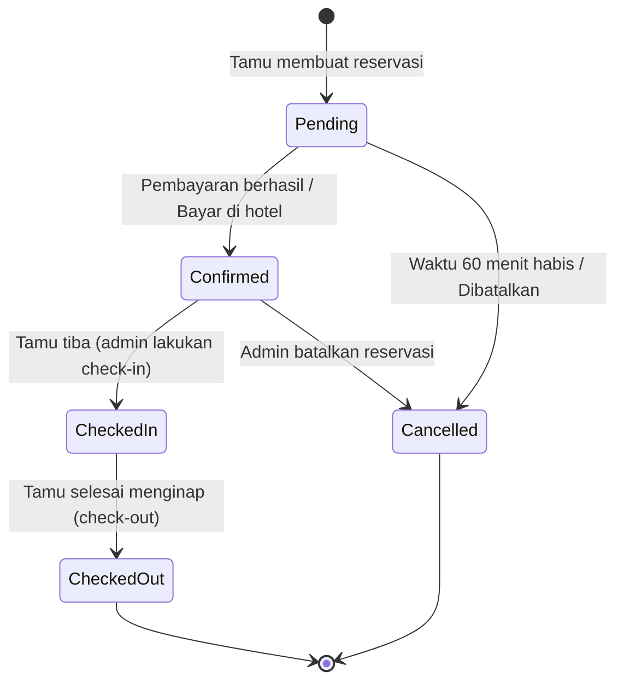
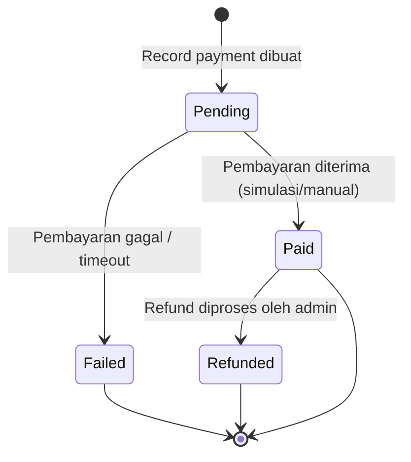

# 🏨 THE EAST HOTEL — DOKUMENTASI TEKNIS LENGKAP & MASTER GUIDE

> **Nama Proyek:** The East Hotel Management System  
> **Konsep:** Luxury Tropical Hotel in Bali  
> **Tanggal Dibuat:** November 2026  
> **Versi:** 1.0.0

---

## 1. GAMBARAN UMUM ARSITEKTUR

Sistem ini dibangun dengan arsitektur **Monorepo Fullstack** — satu repositori yang mengandung tiga lapisan aplikasi yang saling terintegrasi:

```
┌─────────────────────────────────────────────────────────────────┐
│                   THE EAST HOTEL SYSTEM                         │
│                                                                 │
│  ┌────────────────┐    REST API    ┌─────────────────────────┐  │
│  │  React.js SPA  │ ◄────────────► │                         │  │
│  │  (Sisi Tamu)   │  JSON over HTTP│   Laravel 11 Backend    │  │
│  │  Port :5173    │                │   (PHP 8.2+)            │  │
│  │  (dev mode)    │                │   Port :8000            │  │
│  └────────────────┘                │                         │  │
│                                    │  ┌───────────────────┐  │  │
│  ┌────────────────┐   Server-Side  │  │  SQLite Database  │  │  │
│  │  Blade Admin   │ ◄─────────────►│  │  (database.sqlite)│  │  │
│  │  Panel (HTML)  │   Rendered PHP │  └───────────────────┘  │  │
│  │  /admin/*      │                │                         │  │
│  └────────────────┘                └─────────────────────────┘  │
└─────────────────────────────────────────────────────────────────┘
```

**Penjelasan singkat:**
- **React.js SPA** = Halaman yang dilihat tamu hotel (booking, lihat kamar, cek reservasi). Berjalan di browser, berkomunikasi ke backend via **REST API (JSON)**.
- **Blade Admin Panel** = Halaman yang digunakan admin/staf hotel. Dirender langsung di server PHP tanpa REST API — lebih cepat dan lebih aman untuk operasional internal.
- **Laravel 11 Backend** = Otak sistem. Mengelola semua logika bisnis, validasi, database, dan autentikasi.
- **SQLite** = Database utama yang aktif saat ini. File tunggal `database/database.sqlite`.

---

## 2. STACK TEKNOLOGI LENGKAP

### 🖥️ Backend (Server-Side)

| Komponen | Teknologi | Versi | Fungsi |
|---|---|---|---|
| **Framework PHP** | Laravel | 12.x (Laravel 11 API) | Routing, Middleware, ORM, Validasi |
| **Bahasa** | PHP | ^8.2 | Eksekusi server-side |
| **Database Aktif** | SQLite | Bawaan PHP | Penyimpanan data utama (file-based) |
| **Database Alternatif** | MySQL | XAMPP / 8.x | Tersedia untuk produksi |
| **ORM** | Eloquent ORM | Bawaan Laravel | Query builder & relasi antar tabel |
| **Autentikasi API** | Laravel Sanctum | ^4.0 | Bearer Token untuk REST API |
| **Autentikasi Web** | Laravel Session | Bawaan Laravel | Cookie session untuk Admin Panel |
| **CORS** | HandleCors Middleware | Bawaan Laravel | Izinkan React.js berbeda port |
| **Enkripsi Password** | Bcrypt | 12 rounds | Hash password aman |
| **Queue/Job** | Laravel Queue | Database Driver | Proses background (email, dll) |
| **Dependency Manager** | Composer | ^2.x | Manajemen paket PHP |
| **Testing** | PHPUnit | ^11.5 | Unit & Feature test |

### 🎨 Frontend (Client-Side) — Sisi Tamu

| Komponen | Teknologi | Versi | Fungsi |
|---|---|---|---|
| **Framework JS** | React.js | ^19.3.1 | UI interaktif berbasis komponen |
| **Build Tool** | Vite | ^6.0 | Bundler & Hot Module Replacement |
| **CSS Framework** | Tailwind CSS | ^4.0 | Utility-first styling |
| **Icon Library** | Lucide React | ^1.79.0 | Ikon SVG modern |
| **HTTP Client** | Native Fetch API | Browser built-in | Panggil REST API backend |
| **Plugin Vite** | @vitejs/plugin-react | ^4.7.0 | JSX transpilation |
| **Laravel Bridge** | laravel-vite-plugin | ^1.2.0 | Integrasi asset Vite ↔ Blade |
| **Package Manager** | npm | ^10.x | Manajemen paket Node.js |

### 🛠️ Tools & Environment

| Tool | Fungsi |
|---|---|
| **XAMPP** | Web server lokal (Apache + MySQL + phpMyAdmin) |
| **PHP built-in server** | `php artisan serve` — development server |
| **phpMyAdmin** | GUI untuk MySQL (hanya jika pakai MySQL) |
| **Artisan CLI** | Command-line tool Laravel |
| **Laravel Pint** | PHP Code Formatter |
| **Concurrently** | Jalankan banyak proses sekaligus (`npm run dev + php artisan serve`) |

---

## 3. STRUKTUR FOLDER PROYEK

```
c:\the-east-hotel-api\
│
├── 📂 app/
│   ├── Http/
│   │   ├── Controllers/
│   │   │   ├── Admin/              ← Controller untuk Admin Panel (Blade/Web)
│   │   │   │   ├── AdminAuthController.php
│   │   │   │   ├── AdminDashboardController.php
│   │   │   │   ├── AdminReservationController.php
│   │   │   │   ├── AdminRoomController.php
│   │   │   │   ├── AdminRoomTypeController.php
│   │   │   │   ├── AdminAmenityController.php
│   │   │   │   ├── AdminGuestController.php
│   │   │   │   ├── AdminPaymentController.php
│   │   │   │   └── AdminUserController.php
│   │   │   └── Api/                ← Controller untuk REST API (React Frontend)
│   │   │       ├── AuthController.php
│   │   │       ├── PublicController.php
│   │   │       └── Admin/          ← API untuk Admin (dengan Sanctum Token)
│   │   └── Middleware/
│   │       └── RoleMiddleware.php  ← Cek role: admin atau staff
│   ├── Models/
│   │   ├── User.php                ← Admin & Staff
│   │   ├── Guest.php               ← Data tamu hotel
│   │   ├── RoomType.php            ← Tipe kamar (Deluxe, Villa, dll)
│   │   ├── Room.php                ← Unit kamar fisik (101, 201, V01, dll)
│   │   ├── Amenity.php             ← Fasilitas hotel
│   │   ├── Reservation.php         ← Data reservasi/booking
│   │   ├── ReservationDetail.php   ← Detail kamar per reservasi
│   │   └── Payment.php             ← Data pembayaran
│   ├── Services/
│   │   └── ReservationService.php  ← Logika bisnis booking (anti double-booking)
│   └── Providers/
│       └── AppServiceProvider.php
│
├── 📂 config/
│   ├── hotel.php                   ← Konfigurasi bisnis hotel (tarif, pajak, dll)
│   ├── database.php                ← Konfigurasi koneksi database
│   ├── auth.php                    ← Guard & provider autentikasi
│   └── sanctum.php                 ← Konfigurasi Laravel Sanctum
│
├── 📂 database/
│   ├── database.sqlite             ← 🗄️ FILE DATABASE AKTIF (semua data tersimpan di sini)
│   ├── migrations/                 ← Skema tabel SQL (versi terkontrol)
│   └── seeders/
│       ├── DatabaseSeeder.php
│       └── HotelSeeder.php         ← Data awal (admin, staff, fasilitas, dll)
│
├── 📂 resources/
│   ├── css/
│   │   └── app.css                 ← CSS utama + Tailwind directives
│   ├── js/
│   │   ├── app.jsx                 ← 🚀 Entry point React.js (render root component)
│   │   └── components/             ← Semua komponen React
│   │       ├── Navbar.jsx          ← Navigasi floating luxury
│   │       ├── Hero.jsx            ← Hero section + search bar
│   │       ├── RoomTypesSection.jsx← Grid kartu kamar (Read dari API)
│   │       ├── RoomDetailModal.jsx ← Popup detail kamar
│   │       ├── BookingModal.jsx    ← 🎯 Form booking 4-step (Create Reservation + Payment)
│   │       ├── LookupModal.jsx     ← Cek & bayar reservasi (Read + Update)
│   │       ├── ExperiencesSection.jsx ← Fasilitas & pengalaman hotel
│   │       ├── StorySection.jsx    ← Cerita & heritage hotel
│   │       └── Footer.jsx          ← Footer hotel
│   └── views/
│       ├── app.blade.php           ← 🏠 Shell HTML untuk React.js SPA
│       ├── welcome.blade.php
│       └── admin/                  ← Template Blade Admin Panel
│
├── 📂 routes/
│   ├── api.php                     ← 🌐 Semua REST API endpoint
│   └── web.php                     ← Route web (React SPA + Admin Panel)
│
├── 📂 public/
│   ├── index.php                   ← Entry point PHP (semua request masuk sini)
│   ├── build/                      ← Hasil build Vite (CSS & JS terkompresi)
│   └── the_east_hotel.sql          ← Dump database MySQL (untuk referensi/backup)
│
├── seed_10_luxury_rooms.php        ← Script seeder 10 tipe kamar luxury
├── vite.config.js                  ← Konfigurasi Vite (React + Tailwind + Laravel)
├── package.json                    ← Dependency Node.js
├── composer.json                   ← Dependency PHP
└── .env                            ← 🔑 Konfigurasi environment (DB, APP_KEY, dll)
```

---

## 4. DATABASE: PENJELASAN LENGKAP

### 🤔 Mengapa Data Ada Tapi Tidak Muncul di phpMyAdmin?

Ini adalah pertanyaan teknis yang sangat penting. Jawabannya ada pada **dua mesin database berbeda yang berjalan terpisah**:

```
┌────────────────────────────────────────────────────────────────┐
│  KOMPUTER ANDA                                                 │
│                                                                │
│  ┌─────────────────────────────┐                              │
│  │  LARAVEL APP (.env)         │                              │
│  │  DB_CONNECTION=sqlite       │                              │
│  │  DB_DATABASE=               │◄── Data tersimpan di sini!  │
│  │  C:/the-east-hotel-api/     │                              │
│  │  database/database.sqlite   │                              │
│  │  (File biner di hard disk)  │                              │
│  └──────────┬──────────────────┘                              │
│             │ Tidak ada koneksi                               │
│             │                                                 │
│  ┌──────────▼──────────────────┐                              │
│  │  MySQL XAMPP (Port 3306)    │                              │
│  │  mysqld.exe (Server daemon) │◄── phpMyAdmin membaca ini!  │
│  │  Database: the_east_hotel   │    TAPI kosong/beda data!   │
│  └─────────────────────────────┘                              │
│                                                                │
│  phpMyAdmin ──────────────────────────────► MySQL XAMPP        │
│  (Hanya bisa baca MySQL, TIDAK BISA baca SQLite)              │
└────────────────────────────────────────────────────────────────┘
```

**Kesimpulan:** Data yang diinput via aplikasi (Laravel) tersimpan di file `database/database.sqlite`. phpMyAdmin hanya bisa menampilkan data dari MySQL Server, bukan dari SQLite. Keduanya adalah database yang sepenuhnya independen.

### 📊 Konfigurasi Database Aktif (`.env`)

```dotenv
DB_CONNECTION=sqlite
DB_DATABASE=C:/the-east-hotel-api/database/database.sqlite
APP_TIMEZONE=Asia/Makassar
```

### 🔄 Cara Pindah ke MySQL (Opsional)

Jika ingin data muncul di phpMyAdmin, ubah `.env`:

```dotenv
DB_CONNECTION=mysql
DB_HOST=127.0.0.1
DB_PORT=3306
DB_DATABASE=the_east_hotel
DB_USERNAME=root
DB_PASSWORD=
```

Lalu jalankan:
```bash
php artisan migrate:fresh --seed
php seed_10_luxury_rooms.php
```

---

## 5. ERD — ENTITY RELATIONSHIP DIAGRAM

Diagram berikut menggambarkan relasi antar tabel secara lengkap dengan semua kolom dan tipe datanya:

```mermaid
erDiagram
    USERS ||--o{ RESERVATIONS : "created_by (FK)"
    USERS ||--o{ PAYMENTS : "processed_by (FK)"
    GUESTS ||--o{ RESERVATIONS : "guest_id (FK)"
    ROOM_TYPES ||--|{ ROOMS : "room_type_id (FK)"
    ROOM_TYPES ||--o{ AMENITY_ROOM_TYPE : "room_type_id (pivot)"
    AMENITIES ||--o{ AMENITY_ROOM_TYPE : "amenity_id (pivot)"
    RESERVATIONS ||--|{ RESERVATION_DETAILS : "reservation_id (FK)"
    RESERVATIONS ||--o| PAYMENTS : "reservation_id (FK)"
    ROOMS ||--o{ RESERVATION_DETAILS : "room_id (FK)"
    ROOM_TYPES ||--o{ RESERVATION_DETAILS : "room_type_id (snapshot FK)"

    USERS {
        bigint id PK
        string name "Nama admin/staf"
        string email UK "Login email"
        string password "Bcrypt hash"
        enum role "admin | staff"
        boolean is_active "Status akun aktif"
        timestamp email_verified_at
        timestamp created_at
        timestamp updated_at
    }

    GUESTS {
        bigint id PK
        string full_name "Nama lengkap tamu"
        string email UK "Email tamu"
        string phone "Nomor telepon"
        string country "Negara asal"
        string id_number "No. KTP / Paspor"
        timestamp created_at
        timestamp updated_at
        timestamp deleted_at "Soft delete"
    }

    ROOM_TYPES {
        bigint id PK
        string name "Nama tipe kamar"
        string slug UK "URL-friendly name"
        text description "Deskripsi luxury"
        tinyint capacity "Maks jumlah tamu"
        decimal price_per_night "Harga per malam IDR"
        smallint size_sqm "Ukuran m2"
        string bed_type "Jenis kasur"
        string image_url "URL foto kamar"
        boolean is_active "Tampil di frontend"
        timestamp created_at
        timestamp updated_at
        timestamp deleted_at "Soft delete"
    }

    ROOMS {
        bigint id PK
        bigint room_type_id FK "→ room_types.id"
        string room_number UK "No. kamar: 101, V01"
        tinyint floor "Lantai kamar"
        enum status "available | maintenance | out_of_service"
        text notes "Catatan teknis"
        timestamp created_at
        timestamp updated_at
        timestamp deleted_at "Soft delete"
    }

    AMENITIES {
        bigint id PK
        string name "Nama fasilitas"
        string description "Deskripsi fasilitas"
        enum scope "hotel | room"
        timestamp created_at
        timestamp updated_at
        timestamp deleted_at "Soft delete"
    }

    AMENITY_ROOM_TYPE {
        bigint amenity_id PK_FK "→ amenities.id"
        bigint room_type_id PK_FK "→ room_types.id"
    }

    RESERVATIONS {
        bigint id PK
        string code UK "Kode unik: TEH-XXXXXX"
        bigint guest_id FK "→ guests.id"
        date check_in "Tanggal masuk"
        date check_out "Tanggal keluar"
        tinyint guests_count "Jumlah tamu"
        smallint nights "Jumlah malam"
        decimal subtotal "Harga sebelum pajak"
        decimal service_amount "Biaya layanan 10 persen"
        decimal tax_amount "PPN 11 persen"
        decimal total_amount "Total tagihan"
        enum status "pending | confirmed | checked_in | checked_out | cancelled"
        timestamp expires_at "Batas bayar (60 mnt)"
        text special_requests "Permintaan khusus"
        bigint created_by FK "→ users.id (nullable)"
        timestamp created_at
        timestamp updated_at
        timestamp deleted_at "Soft delete"
    }

    RESERVATION_DETAILS {
        bigint id PK
        bigint reservation_id FK "→ reservations.id"
        bigint room_id FK "→ rooms.id"
        bigint room_type_id FK "→ room_types.id (snapshot)"
        decimal price_per_night "Harga saat booking"
        smallint nights "Jumlah malam"
        decimal subtotal "price x nights"
        timestamp created_at
        timestamp updated_at
    }

    PAYMENTS {
        bigint id PK
        bigint reservation_id FK "→ reservations.id"
        decimal amount "Nominal dibayar"
        enum method "simulation | pay_at_hotel | cash | bank_transfer"
        enum status "pending | paid | failed | refunded"
        string reference UK "Kode referensi unik"
        timestamp paid_at "Waktu pembayaran"
        bigint processed_by FK "→ users.id (nullable)"
        timestamp created_at
        timestamp updated_at
    }
```

### 📌 Penjelasan Relasi Penting

| Relasi | Jenis | Keterangan |
|---|---|---|
| `room_types` → `rooms` | One-to-Many | Satu tipe kamar punya banyak unit fisik kamar |
| `room_types` ↔ `amenities` | Many-to-Many | Via tabel pivot `amenity_room_type` |
| `guests` → `reservations` | One-to-Many | Satu tamu bisa punya banyak reservasi |
| `reservations` → `reservation_details` | One-to-Many | Satu reservasi bisa mencakup beberapa kamar |
| `reservations` → `payments` | One-to-One | Satu reservasi punya satu record pembayaran |
| `rooms` → `reservation_details` | One-to-Many | Satu kamar bisa dipesan banyak kali (berbeda tanggal) |

---

## 6. BACKEND: LARAVEL 11 API

### Arsitektur Layering

```
HTTP Request
    │
    ▼
routes/api.php ──────► Middleware Pipeline
                              │
                              ├── HandleCors (izinkan cross-origin dari React dev)
                              ├── throttle:10,1 (rate limiting)
                              ├── auth:sanctum (verifikasi Bearer Token)
                              └── RoleMiddleware (cek role admin/staff)
                              │
                              ▼
                        Controller
                              │
                              ├── Form Request Validation (aturan ketat)
                              ├── Panggil Service / Model
                              └── Return JSON Response
                              │
                              ▼
                        Eloquent Model
                              │
                              └── SQLite / MySQL via PDO
```

### Eloquent Models & Fitur Soft Delete

Semua model utama menggunakan **Soft Delete** — data tidak benar-benar dihapus dari database, hanya ditandai dengan kolom `deleted_at`:

```php
// Contoh pada RoomType model
use Illuminate\Database\Eloquent\SoftDeletes;

class RoomType extends Model {
    use SoftDeletes;
    // deleted_at diisi = "dihapus", NULL = "aktif"
}
```

**Keuntungan Soft Delete:**
- Data historis reservasi tetap utuh meskipun kamar/tamu "dihapus"
- Bisa di-restore (pulihkan) kapan saja
- Mencegah error foreign key constraint

### Konfigurasi Bisnis (`config/hotel.php`)

```php
return [
    'name'                   => 'THE EAST HOTEL',
    'service_rate'           => 0.10,   // Biaya layanan 10%
    'tax_rate'               => 0.11,   // PPN 11%
    'payment_expiry_minutes' => 60,     // Reservasi expired dalam 60 menit
    'max_nights'             => 30,     // Maksimal 30 malam
];
```

### Response Format JSON API

Semua endpoint API mengembalikan JSON dengan format konsisten:

```json
// Sukses (200/201):
{
  "id": 1,
  "name": "Deluxe Ocean Terrace",
  "price_per_night": "2850000.00",
  "amenities": [...]
}

// Error Validasi (422):
{
  "message": "The check_in field is required.",
  "errors": {
    "check_in": ["The check_in field is required."]
  }
}

// Error Tidak Ditemukan (404):
{
  "message": "Data tidak ditemukan."
}
```

---

## 7. FRONTEND: REACT.JS (SISI TAMU)

### Cara React Ter-build & Ter-serve

```
resources/js/app.jsx   ←── Entry point
         │
         ▼
   Vite Build Tool
         │
         ▼
public/build/assets/   ←── Hasil bundle (app-[hash].js, app-[hash].css)
         │
         ▼
resources/views/app.blade.php  ←── Shell HTML Laravel yang load asset Vite
         │
         ▼
Browser: http://127.0.0.1:8000/  ←── Tamu membuka halaman ini
```

### Komponen React & Fungsinya

| Komponen | File | CRUD Operation | API Endpoint |
|---|---|---|---|
| `App` | `app.jsx` | **Read** (fetch data awal) | `GET /api/v1/room-types` + `GET /api/v1/amenities` |
| `Navbar` | `Navbar.jsx` | — | — |
| `Hero` | `Hero.jsx` | — (search & scroll) | — |
| `RoomTypesSection` | `RoomTypesSection.jsx` | **Read** (tampilkan kartu kamar) | Data dari props App |
| `RoomDetailModal` | `RoomDetailModal.jsx` | **Read** (detail popup) | Data dari props |
| `BookingModal` | `BookingModal.jsx` | **Create** Reservasi + **Create** Pembayaran | `POST /api/v1/reservations` → `POST /api/v1/reservations/{code}/payments` |
| `LookupModal` | `LookupModal.jsx` | **Read** + **Update** (bayar) | `GET /api/v1/reservations/lookup` → `POST /api/v1/reservations/{code}/payments` |
| `ExperiencesSection` | `ExperiencesSection.jsx` | **Read** (fasilitas hotel) | Data dari props App |
| `Footer` | `Footer.jsx` | — | — |

### State Management (Tanpa Redux)

React.js di proyek ini menggunakan **local state + props drilling** sederhana — cukup untuk skala aplikasi hotel seperti ini:

```
App (State Pusat)
 ├── roomTypes[]          ← Data semua tipe kamar dari API
 ├── amenities[]          ← Data semua fasilitas dari API
 ├── loading              ← Status loading global
 ├── searchParams{}       ← Tanggal & jumlah tamu pencarian
 ├── isBookingOpen        ← Toggle modal booking
 ├── isLookupOpen         ← Toggle modal cek reservasi
 ├── selectedRoomType     ← Kamar yang dipilih untuk booking
 └── detailRoomType       ← Kamar yang dilihat detailnya
```

### Alur Booking 4-Step (BookingModal)

```
Step 1: Pilih Kamar & Tanggal
        (room_type_id, check_in, check_out, guests_count)
        │
        ▼
Step 2: Isi Data Tamu
        (full_name, email, phone, country, special_requests)
        │
        ▼
Step 3: Review & Pilih Metode Bayar
        (Tampilkan rincian harga: subtotal + service 10% + PPN 11%)
        (payment_method: 'simulation' atau 'pay_at_hotel')
        │
        ▼ POST /api/v1/reservations (kirim semua data)
        │
        ▼ Backend: Validasi → Cek ketersediaan → Hitung harga → Simpan → Buat Payment record
        │
        ▼ POST /api/v1/reservations/{code}/payments (jika pilih 'simulation')
        │
        ▼
Step 4: ✅ Sukses
        (Tampilkan Kode Booking: TEH-XXXXXX)
        (Instruksi simpan kode untuk lookup nanti)
```

### Cara React Berkomunikasi ke Backend

React menggunakan **browser's native `fetch()` API** — tidak ada library Axios tambahan untuk komponen utama. Semua request ke endpoint `/api/v1/...`:

```javascript
// Contoh dari BookingModal.jsx — POST membuat reservasi baru:
const res = await fetch('/api/v1/reservations', {
  method: 'POST',
  headers: {
    'Content-Type': 'application/json',
    'Accept': 'application/json',
  },
  body: JSON.stringify({
    room_type_id: formData.room_type_id,
    check_in: formData.check_in,
    check_out: formData.check_out,
    guests_count: formData.guests_count,
    guest: formData.guest,
    payment_method: formData.payment_method,
  }),
});
const data = await res.json();
```

> **Catatan:** Karena React dan Laravel berjalan di **port yang sama** (`:8000`) saat production build, tidak ada masalah CORS. URL `/api/v1/...` adalah relative URL — otomatis ke `http://127.0.0.1:8000/api/v1/...`.

---

## 8. ADMIN PANEL: BLADE TEMPLATE

### Perbedaan Admin Panel vs React Frontend

| Aspek | Admin Panel (Blade) | React Frontend |
|---|---|---|
| **Siapa pengguna** | Admin & Staff hotel | Tamu hotel |
| **Teknologi render** | Server-side (PHP generates HTML) | Client-side (JS generates DOM) |
| **Autentikasi** | Laravel Session (cookie) | Tidak perlu login |
| **Komunikasi data** | Controller langsung query DB | Via REST API (JSON) |
| **URL** | `/admin/*` | `/`, `/rooms`, `/booking` |
| **Keamanan** | Session cookie + CSRF token | Rate limiting |

### URL Admin Panel

```
http://127.0.0.1:8000/admin/login          ← Login
http://127.0.0.1:8000/admin/dashboard      ← Ringkasan statistik
http://127.0.0.1:8000/admin/reservations   ← Kelola reservasi
http://127.0.0.1:8000/admin/payments       ← Kelola pembayaran
http://127.0.0.1:8000/admin/guests         ← Data tamu
http://127.0.0.1:8000/admin/room-types     ← CRUD tipe kamar
http://127.0.0.1:8000/admin/rooms          ← CRUD unit kamar
http://127.0.0.1:8000/admin/amenities      ← CRUD fasilitas
http://127.0.0.1:8000/admin/users          ← Kelola pengguna sistem
```

---

## 9. AUTENTIKASI & KEAMANAN

### Dua Sistem Autentikasi Paralel

```
┌─────────────────────────────────────────────────────────────┐
│  SISTEM 1: Laravel Session (untuk Admin Panel Web)          │
│                                                             │
│  POST /admin/login → Validasi → Session::put('user_id')     │
│  → Cookie PHPSESSID dikirim ke browser                      │
│  → Setiap request berikutnya kirim cookie → Terautentikasi  │
│                                                             │
│  Logout → Session::flush() → Cookie dihapus                 │
└─────────────────────────────────────────────────────────────┘

┌─────────────────────────────────────────────────────────────┐
│  SISTEM 2: Laravel Sanctum Bearer Token (untuk REST API)    │
│                                                             │
│  POST /api/v1/auth/login → Return { token: "1|xyz..." }     │
│  → Klien simpan token (localStorage atau memory)            │
│  → Setiap request API: Header Authorization: Bearer xyz...  │
│  → Middleware 'auth:sanctum' verifikasi token di DB         │
│                                                             │
│  Logout → DELETE token dari tabel personal_access_tokens    │
└─────────────────────────────────────────────────────────────┘
```

### Role-Based Access Control (RBAC)

```php
// RoleMiddleware.php
public function handle(Request $request, Closure $next, ...$roles): Response {
    if (!auth()->check() || !in_array(auth()->user()->role, $roles)) {
        abort(403, 'Akses ditolak. Hak istimewa tidak mencukupi.');
    }
    return $next($request);
}
```

| Role | Hak Akses |
|---|---|
| **admin** | Full CRUD semua data, termasuk hapus master data dan kelola pengguna |
| **staff** | Bisa buat/lihat reservasi, proses pembayaran, edit data tamu. Tidak bisa hapus kamar atau akun pengguna |

### Proteksi Keamanan Lainnya

- **CSRF Token** — Semua form Blade dilindungi `@csrf` (mencegah Cross-Site Request Forgery)
- **SQL Injection Protection** — Semua query menggunakan Eloquent ORM / PDO prepared statements
- **XSS Protection** — Output Blade menggunakan `{{ $variable }}` yang otomatis di-escape
- **Rate Limiting** — `throttle:20,1` = maks 20 request per menit per IP untuk endpoint booking

---

## 10. ALUR PEMBUATAN INVOICE & PEMBAYARAN

### Bagaimana Harga Dihitung (Backend Only)

Semua perhitungan dilakukan **eksklusif di backend** — frontend TIDAK boleh menghitung harga sendiri untuk mencegah manipulasi:

```
Input dari Tamu:
  room_type_id = 14 (One-Bedroom Private Pool Villa)
  check_in     = 2026-11-27
  check_out    = 2026-11-30
  guests_count = 2

Backend Proses:
  price_per_night = Rp 6.200.000  (dari tabel room_types)
  nights          = 3             (hitung: check_out - check_in)

Formula Kalkulasi:
  subtotal        = 6.200.000 × 3          = Rp 18.600.000
  service_amount  = 18.600.000 × 10%       = Rp  1.860.000
  tax_base        = 18.600.000 + 1.860.000 = Rp 20.460.000
  tax_amount      = 20.460.000 × 11%       = Rp  2.250.600
  total_amount    = 18.600.000 + 1.860.000 + 2.250.600 = Rp 22.710.600
```

### Alur Lengkap Pembuatan Reservasi & Invoice

```
[TAMU] Isi form BookingModal
        │
        ▼ POST /api/v1/reservations
        │
[BACKEND] PublicController@storeReservation
        │
        ├─ 1. Validasi input (check_in < check_out, kapasitas, dll)
        │
        ├─ 2. Panggil ReservationService::create()
        │        │
        │        ├─ DB::transaction() — mulai transaksi database
        │        │
        │        ├─ Cek/Buat data Guest (berdasarkan email)
        │        │
        │        ├─ lockForUpdate() — kunci baris kamar untuk cegah double-booking
        │        │
        │        ├─ Cari kamar kosong yang bebas tanggal bertabrakan
        │        │
        │        ├─ Hitung harga (subtotal, service, tax, total)
        │        │
        │        ├─ Buat record di tabel `reservations`
        │        │    code = "TEH-" + random 6 karakter unik
        │        │
        │        ├─ Buat record di tabel `reservation_details`
        │        │    (snapshot harga saat itu)
        │        │
        │        ├─ Buat record di tabel `payments`
        │        │    status = 'pending'
        │        │    expires_at = sekarang + 60 menit
        │        │
        │        └─ DB::commit() — simpan semua sekaligus
        │
        ▼ Response JSON: { code: "TEH-ABC123", total: 22710600, ... }
        │
[TAMU] Terima kode booking → Step 4 (Sukses)
        │
        ▼ (Jika pilih 'simulation' payment)
        │
[TAMU] POST /api/v1/reservations/TEH-ABC123/payments
        │
[BACKEND] Update payment.status = 'paid'
          Update reservation.status = 'confirmed'
          │
          ▼ Response: { message: "Pembayaran berhasil", status: "confirmed" }
```

### Metode Pembayaran yang Tersedia

| Metode | Kode | Keterangan |
|---|---|---|
| **Simulasi Online** | `simulation` | Langsung konfirmasi otomatis (untuk testing/demo) |
| **Bayar di Hotel** | `pay_at_hotel` | Status tetap `pending`, tamu datang dan bayar langsung |
| **Tunai** | `cash` | Diproses oleh staf via admin panel |
| **Transfer Bank** | `bank_transfer` | Diverifikasi manual oleh staf |

---

## 11. BAGAIMANA FRONTEND & BACKEND TERSINKRONISASI

Ini adalah inti dari bagaimana React.js dan Laravel bekerja bersama secara real-time:

### Diagram Alur Sinkronisasi Penuh

```
                    BROWSER (React.js)
                         │
                    Buka halaman /
                         │
                    useEffect() dipanggil
                         │
              ┌──────────┴──────────┐
              │                     │
        GET /api/v1/           GET /api/v1/
        room-types             amenities
              │                     │
              └──────────┬──────────┘
                         │ (Promise.all — paralel)
                         │
                    LARAVEL BACKEND
                         │
                    routes/api.php → PublicController
                         │
                    Query DB: RoomType::with('amenities')
                              ->where('is_active', true)
                              ->whereNull('deleted_at')
                              ->get()
                         │
                    Return JSON array
                         │
                    BROWSER menerima JSON
                         │
                    setRoomTypes(data) — React state diupdate
                         │
                    Re-render otomatis: kartu kamar tampil
```

### Sinkronisasi Status Kamar (Real-time Logic)

Ketika admin membuka halaman `/admin/rooms`, backend **otomatis mensinkronisasi** status visual kamar berdasarkan reservasi aktif hari ini:

```php
// AdminRoomController.php
$today = today()->toDateString();

// Query: kamar mana saja yang sedang ditempati hari ini?
$activeReservations = DB::table('reservation_details as d')
    ->join('reservations as r', 'r.id', '=', 'd.reservation_id')
    ->join('guests as g', 'g.id', '=', 'r.guest_id')
    ->whereIn('r.status', ['confirmed', 'checked_in'])
    ->where('r.check_in', '<=', $today)   // Sudah check-in
    ->where('r.check_out', '>', $today)   // Belum check-out
    ->select('d.room_id', 'r.code', 'g.full_name as guest_name')
    ->get()
    ->keyBy('room_id');
```

Hasilnya ditampilkan di Blade view dengan aturan:
- 🔴 **Dihuni** = Kamar ada di `$activeReservations`
- 🟡 **Perbaikan** = Status fisik kamar = `maintenance`
- ⚫ **Tidak Aktif** = Status fisik kamar = `out_of_service`
- 🟢 **Tersedia** = Tidak ada tamu hari ini + status `available`

### Alur Sinkronisasi Soft Delete

```
Admin klik "Hapus" Tipe Kamar
        │
        ▼
DELETE /admin/room-types/{id}
        │
        ▼
Eloquent SoftDelete: UPDATE room_types SET deleted_at = NOW() WHERE id = ?
        │
        ▼
Kamar fisik yang terkait TIDAK dihapus (hanya tipe kamarnya)
        │
        ▼
API /api/v1/room-types → WHERE deleted_at IS NULL
        │
        ▼
Kamar yang dihapus TIDAK lagi tampil di React frontend tamu ✅
```

---

## 12. SEMUA ENDPOINT REST API

### 🌐 Endpoint Publik (Tidak Perlu Login)

| Method | Endpoint | Fungsi |
|---|---|---|
| `GET` | `/api/v1/room-types` | Daftar semua tipe kamar aktif (dengan fasilitas) |
| `GET` | `/api/v1/room-types/{slug}` | Detail satu tipe kamar |
| `GET` | `/api/v1/amenities` | Daftar semua fasilitas hotel |
| `POST` | `/api/v1/reservations` | 🎯 Buat reservasi baru (dari form tamu) |
| `GET` | `/api/v1/reservations/lookup` | Cek status reservasi (kode + email) |
| `POST` | `/api/v1/reservations/{code}/payments` | Proses pembayaran |

### 🔐 Endpoint Autentikasi

| Method | Endpoint | Fungsi |
|---|---|---|
| `POST` | `/api/v1/auth/login` | Login → Dapat Bearer Token |
| `POST` | `/api/v1/auth/logout` | Logout → Hapus token (auth:sanctum) |
| `GET` | `/api/v1/auth/me` | Info user login saat ini |

### 👤 Endpoint Admin & Staff (Bearer Token Required)

| Method | Endpoint | Role | Fungsi |
|---|---|---|---|
| `GET` | `/api/v1/admin/dashboard` | admin,staff | Statistik dashboard |
| `GET` | `/api/v1/admin/reservations` | admin,staff | List reservasi |
| `POST` | `/api/v1/admin/reservations` | admin,staff | Buat reservasi via admin |
| `GET` | `/api/v1/admin/reservations/{id}` | admin,staff | Detail reservasi |
| `PATCH` | `/api/v1/admin/reservations/{id}/status` | admin,staff | Update status reservasi |
| `GET` | `/api/v1/admin/payments` | admin,staff | List pembayaran |
| `PATCH` | `/api/v1/admin/payments/{id}` | admin,staff | Update status pembayaran |
| `GET` | `/api/v1/admin/guests` | admin,staff | List tamu |
| `PUT` | `/api/v1/admin/guests/{id}` | admin,staff | Update data tamu |
| `GET` | `/api/v1/admin/room-types` | admin,staff | List tipe kamar (admin view) |
| `GET` | `/api/v1/admin/rooms` | admin,staff | List kamar (admin view) |

### 👑 Endpoint Khusus Admin

| Method | Endpoint | Fungsi |
|---|---|---|
| `POST` | `/api/v1/admin/room-types` | Tambah tipe kamar baru |
| `PUT` | `/api/v1/admin/room-types/{id}` | Edit tipe kamar |
| `DELETE` | `/api/v1/admin/room-types/{id}` | Hapus tipe kamar (soft delete) |
| `POST` | `/api/v1/admin/rooms` | Tambah unit kamar fisik |
| `PUT` | `/api/v1/admin/rooms/{id}` | Edit kamar |
| `DELETE` | `/api/v1/admin/rooms/{id}` | Hapus kamar (soft delete) |
| `POST` | `/api/v1/admin/amenities` | Tambah fasilitas |
| `PUT/DELETE` | `/api/v1/admin/amenities/{id}` | Edit/Hapus fasilitas |
| `GET` | `/api/v1/admin/users` | List pengguna sistem |
| `POST` | `/api/v1/admin/users` | Tambah pengguna |
| `PUT` | `/api/v1/admin/users/{id}` | Edit pengguna |
| `DELETE` | `/api/v1/admin/users/{id}` | Hapus pengguna |
| `GET` | `/api/v1/admin/reports/summary` | Laporan ringkasan |
| `DELETE` | `/api/v1/admin/guests/{id}` | Hapus data tamu |

---

## 13. LOGIKA BISNIS INTI

### A. Anti Double-Booking (Teorema Tumpang-Tindih Tanggal)

Dua periode menginap dikatakan **bertabrakan** jika:

$$\text{existing\_check\_in} < \text{new\_check\_out} \quad \text{AND} \quad \text{existing\_check\_out} > \text{new\_check\_in}$$

```php
// ReservationService.php
private function bookedRoomIds(string $checkIn, string $checkOut, bool $lock = false): array {
    return ReservationDetail::query()
        ->whereHas('reservation', function ($q) use ($checkIn, $checkOut) {
            $q->whereNotIn('status', ['cancelled', 'checked_out'])
              ->where('check_in', '<', $checkOut)   // ← kunci matematis
              ->where('check_out', '>', $checkIn);  // ← kunci matematis
        })
        ->pluck('room_id')
        ->toArray();
}
```

### B. Pessimistic Locking (Cegah Race Condition)

Ketika 2 tamu menekan tombol "Pesan" bersamaan pada detik yang sama:

```php
return DB::transaction(function () use ($data) {
    // Kunci baris kamar → transaksi lain harus TUNGGU
    $rooms = Room::where('room_type_id', $data['room_type_id'])
        ->where('status', 'available')
        ->lockForUpdate()  // ← SELECT ... FOR UPDATE (SQL)
        ->get();

    // Filter kamar yang benar-benar bebas
    $booked = $this->bookedRoomIds($data['check_in'], $data['check_out'], true);
    $room = $rooms->reject(fn($r) => in_array($r->id, $booked))->first();

    if (!$room) {
        throw ValidationException::withMessages([
            'room_type_id' => 'Maaf, kamar untuk tanggal tersebut baru saja terisi.'
        ]);
    }
    // ... simpan reservasi
}, 3); // Coba ulang 3x jika deadlock
```

### C. Diagram Transisi Status Reservasi



### D. Diagram Transisi Status Pembayaran



### E. Rumus Lengkap Kalkulasi Tarif

$$\text{nights} = \text{check\_out} - \text{check\_in} \quad (\text{dalam hari})$$

$$\text{subtotal} = \text{price\_per\_night} \times \text{nights}$$

$$\text{service\_amount} = \text{ROUND}(\text{subtotal} \times 0.10)$$

$$\text{tax\_amount} = \text{ROUND}((\text{subtotal} + \text{service\_amount}) \times 0.11)$$

$$\text{total\_amount} = \text{subtotal} + \text{service\_amount} + \text{tax\_amount}$$

---

## 14. REQUEST LIFECYCLE & MIDDLEWARE

### Alur Lengkap Setiap HTTP Request

```
Browser / React.js / Admin
        │
        ▼ HTTP Request ke http://127.0.0.1:8000/...
        │
public/index.php  ← SEMUA request masuk satu pintu ini
        │
        ▼
bootstrap/app.php ← Inisialisasi Laravel Application
        │
        ▼
Global Middleware Pipeline:
  1. HandleCors              → Tambah header CORS (izinkan :5173 dev)
  2. PreventRequestsDuring   → Cek maintenance mode
     Maintenance
  3. ValidatePostSize        → Tolak body terlalu besar
  4. TrimStrings             → Trim whitespace input
  5. ConvertEmptyStrings     → Null-ify string kosong
     ToNull
        │
        ▼
Router (routes/web.php atau routes/api.php)
        │
  ┌─────┴──────┐
  │            │
web.*       api/v1/*
  │            │
  ▼            ▼
Route Middleware:
  - 'auth'          → Cek session (web)
  - 'auth:sanctum'  → Cek Bearer Token (API)
  - 'role:admin'    → Cek hak admin
  - 'throttle:20,1' → Rate limiter
        │
        ▼
Controller Method
        │
  ├── Form Request Validation (422 jika gagal)
  ├── Business Logic (Service Layer)
  ├── Eloquent Model → PDO → SQLite/MySQL
  └── Return Response
        │
        ▼
Response:
  - Blade View (HTML) untuk web.*
  - JSON untuk api/v1/*
        │
        ▼
Browser menerima response
```

---

## 15. CARA MENJALANKAN PROYEK

### Prasyarat

```
✅ PHP >= 8.2
✅ Composer >= 2.x
✅ Node.js >= 18.x
✅ npm >= 10.x
```

### Langkah Instalasi (Pertama Kali)

```bash
# 1. Clone atau masuk ke folder proyek
cd c:\the-east-hotel-api

# 2. Install dependency PHP
composer install

# 3. Install dependency Node.js
npm install

# 4. Salin file environment
copy .env.example .env

# 5. Generate application key
php artisan key:generate

# 6. Jalankan migrasi database (buat semua tabel)
php artisan migrate

# 7. Isi data awal (admin, staff, fasilitas)
php artisan db:seed

# 8. Isi 10 tipe kamar luxury
php seed_10_luxury_rooms.php

# 9. Build asset frontend (React + CSS)
npm run build
```

### Cara Menjalankan (Mode Development)

```bash
# Satu perintah untuk semua proses sekaligus:
composer run dev

# Yang dijalankan secara paralel:
#   php artisan serve          → Backend di http://127.0.0.1:8000
#   npm run dev                → Vite HMR di http://127.0.0.1:5173
#   php artisan queue:listen   → Worker queue background
#   php artisan pail           → Log viewer real-time
```

> **Tip:** Saat `npm run dev` aktif, React menggunakan **Hot Module Replacement (HMR)** — perubahan kode JSX langsung terlihat di browser tanpa reload halaman.

### URL Penting

| URL | Keterangan |
|---|---|
| `http://127.0.0.1:8000/` | 🌴 Frontend tamu (The East Hotel website) |
| `http://127.0.0.1:8000/admin/login` | 🔐 Login Admin Panel |
| `http://127.0.0.1:8000/admin/dashboard` | 📊 Dashboard Admin |
| `http://127.0.0.1:8000/admin/room-types` | 🏨 CRUD Tipe Kamar |
| `http://127.0.0.1:8000/admin/rooms` | 🚪 CRUD Unit Kamar |
| `http://127.0.0.1:8000/admin/reservations` | 📋 Kelola Reservasi |
| `http://127.0.0.1:8000/admin/payments` | 💳 Kelola Pembayaran |

### Artisan Commands Berguna

```bash
php artisan migrate:fresh --seed   # Reset semua tabel + isi data awal
php artisan cache:clear            # Hapus cache aplikasi
php artisan route:clear            # Hapus cache routing
php artisan view:clear             # Hapus cache Blade views
php artisan config:clear           # Hapus cache konfigurasi
php artisan tinker                 # Interactive PHP shell (debug)
```

---

## 16. KREDENSIAL AKUN

### Admin Panel (`/admin/login`)

| Peran | Email | Password | Hak Akses |
|---|---|---|---|
| **Admin** | `admin@theeasthotel.test` | `password123` | Full CRUD semua data |
| **Staff** | `staf@theeasthotel.test` | `password123` | Operasional (reservasi, pembayaran, tamu) |

### REST API Login

```bash
curl -X POST http://127.0.0.1:8000/api/v1/auth/login \
  -H "Content-Type: application/json" \
  -H "Accept: application/json" \
  -d '{"email":"admin@theeasthotel.test","password":"password123"}'

# Response:
# { "token": "1|AbCdEfGhIjKlMnOpQr...", "user": {...} }
```

---

## 🏨 Daftar 10 Tipe Kamar Luxury

| # | Nama Kamar | Harga/Malam | Ukuran | Kapasitas | Unit |
|---|---|---|---|---|---|
| 1 | Deluxe Ocean Terrace | Rp 2.850.000 | 52 m² | 2 tamu | 3 (101-103) |
| 2 | Premier Tropical Garden Suite | Rp 3.450.000 | 68 m² | 2 tamu | 2 (104-105) |
| 3 | Cliffside Ocean Suite | Rp 4.750.000 | 85 m² | 3 tamu | 2 (201-202) |
| 4 | One-Bedroom Private Pool Villa | Rp 6.200.000 | 125 m² | 2 tamu | 3 (V01-V03) |
| 5 | Two-Bedroom Family Sanctuary Villa | Rp 8.900.000 | 210 m² | 4 tamu | 2 (V04-V05) |
| 6 | The Sunset Honeymoon Pool Villa | Rp 7.500.000 | 140 m² | 2 tamu | 2 (H01-H02) |
| 7 | Oceanfront Plunge Pool Suite | Rp 5.600.000 | 95 m² | 3 tamu | 2 (203-204) |
| 8 | Agung Mountain View Villa | Rp 6.850.000 | 160 m² | 2 tamu | 2 (V06-V07) |
| 9 | Three-Bedroom Royal Heritage Villa | Rp 14.500.000 | 380 m² | 6 tamu | 1 (RH1) |
| 10 | The Presidential Cliff Residence | Rp 28.000.000 | 650 m² | 8 tamu | 1 (PCR1) |

---

*Dokumentasi ini dibuat secara otomatis dan mencerminkan kondisi proyek per November 2026.*  
*THE EAST HOTEL — Luxury Tropical Hotel in Bali 🌴*
