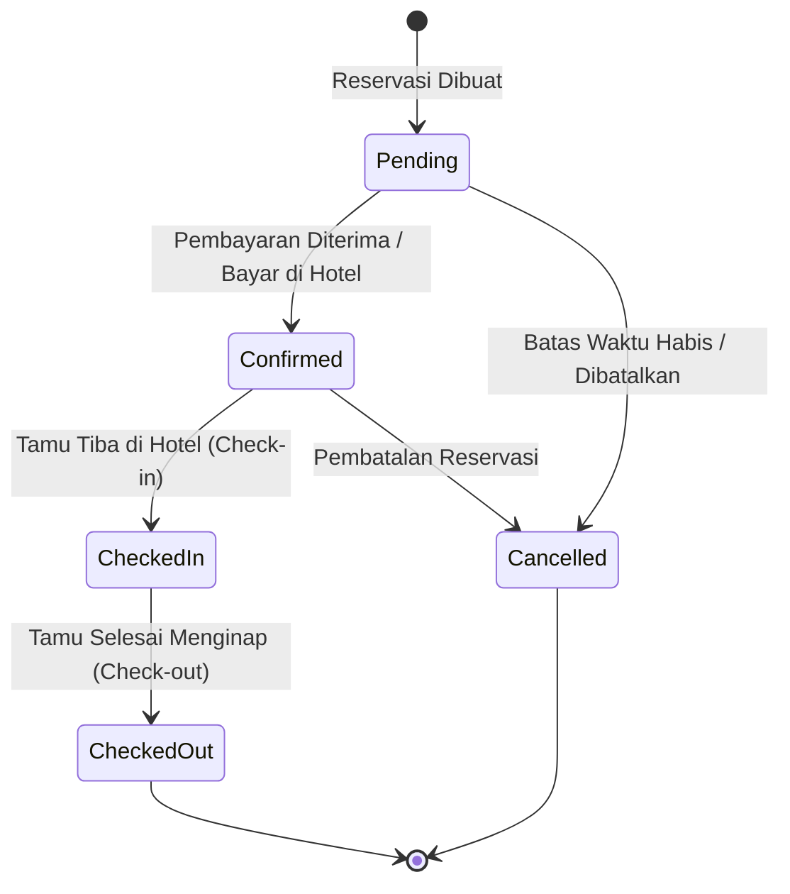

# 🏨 THE EAST HOTEL – BUKU PANDUAN & DOKUMENTASI TEKNIS MASTER
 
> **Framework:** Laravel 11 (PHP 8.2+)  
> **Frontend Tamu (Guest-Facing):** React.js + Tailwind CSS + Lucide Icons (Tema Luxury Tropical Bali)  
> **Arsitektur:** REST API Backend + React Guest Frontend + Server-Side Admin Panel (Blade Template)  
> **Database:** Dual Engine Support (SQLite File-based & MySQL XAMPP Relational)  
> **Autentikasi:** Laravel Session Guard (Web Panel) & Laravel Sanctum Bearer Token (REST API)

---


## 1. Kredensial Akun & Hak Akses (RBAC)

Aplikasi menerapkan sistem otentikasi berbasis peran (*Role-Based Access Control* - RBAC) yang terbagi menjadi dua level pengguna:

| Peran | Email | Kata Sandi | Batasan Hak Akses |
|---|---|---|---|
| **Admin** | `admin@theeasthotel.test` | `password123` | **Full Access:** CRUD Kamar, Tipe Kamar, Fasilitas, Pengguna Sistem, Tamu, Reservasi, dan Pembayaran |
| **Staff** | `staf@theeasthotel.test` | `password123` | **Operational Access:** Membuat/mengelola Reservasi, memproses Pembayaran, melihat/mengedit data Tamu, melihat ketersediaan Kamar (dilarang menghapus master data kamar dan akun pengguna) |

* **URL Login Web:** [http://127.0.0.1:8000/admin/login](http://127.0.0.1:8000/admin/login)
* **API Login Endpoint:** `POST http://127.0.0.1:8000/api/v1/auth/login`

---

## 2. DATABASE


### 🔬 Akar Masalah Teknis:

```dotenv
DB_CONNECTION=sqlite
DB_DATABASE=C:/the-east-hotel-api/database/database.sqlite
```

**Dua Mesin Database Berjalan Terpisah di Komputer Anda:**
   * **Database 1: SQLite (`database/database.sqlite`)**  
     Database ini merupakan **file biner mandiri** di dalam folder proyek Anda. SQLite dijalankan langsung oleh pustaka PHP internal tanpa memerlukan port jaringan, tanpa user, dan tanpa password.
   * **Database 2: MySQL XAMPP (Port 3306)**  
     Database ini berupa **server daemon terpisah** (`mysqld.exe`) yang dikelola oleh XAMPP Control Panel. phpMyAdmin (`http://localhost/phpmyadmin`) adalah aplikasi web PHP yang **hanya membaca dan menampilkan data dari server MySQL XAMPP**.

---


## 3. Diagram Relasi Database (Entity Relationship Diagram - ERD)

Aplikasi dibangun di atas skema relasional terstandarisasi untuk mencegah redundansi dan anomali data:


## 4. Arsitektur Request Lifecycle & Keamanan

Setiap request HTTP yang dikirimkan oleh klien melewati lapisan filter keamanan bertingkat:

```
[Browser / Klien REST]
       │
       ▼ (Permintaan HTTP)
1. Web Server / PHP Built-in Server
       │
       ▼ (bootstrap/app.php)
2. Laravel Global Middleware:
   - HandleCors
   - PreventRequestsDuringMaintenance
   - ValidatePostSize
   - TrimStrings & ConvertEmptyStringsToNull
       │
       ▼ (Routing Layer: routes/web.php atau routes/api.php)
3. Route-Specific Middleware:
   - 'auth' atau 'auth:sanctum' -> Autentikasi sesi / token
   - 'role:admin' / 'role:admin,staff' -> Pemeriksaan otorisasi peran
   - 'throttle' -> Proteksi brute-force & spamming request
       │
       ▼ (Controller & Form Request Validation)
4. Admin Controllers:
   - Validasi input ketat (mencegah SQL Injection & XSS)
   - Panggilan Layanan Transaksi Database (DB::transaction)
       │
       ▼ (Presentation Layer)
5. View Compilation:
   - Blade Template Rendering
   - Sanitasi keluaran via escaping otomatis {{ $variabel }}
```

---

## 5. Bedah Logika Bisnis & Mesin CRUD Otomatis

### A. Logika Sinkronisasi Status Kamar Dinamis (Tersedia vs Penuh)
Di hotel operasional nyata, kamar tidak boleh hanya mengandalkan status statis dari tabel `rooms`. Jika hari ini ada tamu menginap, kamar wajib otomatis ditandai **Penuh**, dan saat tamu check-out kembali menjadi **Tersedia**.

#### 🧠 Implementasi Algoritma (`app/Http/Controllers/Admin/AdminRoomController.php`):
Ketika halaman daftar kamar dibuka, controller menjalankan query sinkronisasi terhadap tanggal hari ini:
```php
$today = today()->toDateString(); // Tanggal berjalan sistem (Y-m-d)

// Deteksi seluruh kamar yang sedang terikat reservasi aktif hari ini
$activeReservations = DB::table('reservation_details as d')
    ->join('reservations as r', 'r.id', '=', 'd.reservation_id')
    ->join('guests as g', 'g.id', '=', 'r.guest_id')
    ->whereIn('r.status', ['confirmed', 'checked_in'])
    ->where('r.check_in', '<=', $today)  // Tamu sudah/sedang check-in
    ->where('r.check_out', '>', $today)  // Tamu belum saatnya check-out
    ->select('d.room_id', 'r.id as reservation_id', 'r.code', 'g.full_name as guest_name')
    ->get()
    ->keyBy('room_id');
```

#### 🎨 Aturan Evaluasi di Blade (`resources/views/admin/rooms/index.blade.php`):
1. **Perbaikan (`maintenance`):** Jika status fisik kamar memang diset dalam perbaikan teknis.
2. **Tidak Aktif (`out_of_service`):** Jika kamar sengaja dimatikan dari inventori.
3. **Penuh (Occupied):** Jika ID kamar ditemukan di dalam daftar `$activeReservations`. Sistem langsung mencetak badge merah dan menautkan nama tamu serta kode reservasi aktifnya.
4. **Tersedia (Available):** Jika kamar operasional dan tidak ada tamu yang menempati kamar hari ini.

---

### B. Mesin Anti Double-Booking & Kunci Konkurensi
* **File:** `app/Services/ReservationService.php`

#### 1. Teorema Tumpang-Tindih Tanggal (Date Overlap Detection):
Dua periode menginap $[A_{in}, A_{out}]$ dan $[B_{in}, B_{out}]$ dikatakan **bertabrakan** jika dan hanya jika:
$$\text{Existing Check-in} < \text{New Check-out} \quad \text{DAN} \quad \text{Existing Check-out} > \text{New Check-in}$$
*(Ketentuan: Tanggal check-out tamu A yang bertepatan dengan tanggal check-in tamu B pada hari yang sama TIDAK dianggap bertabrakan).*

#### 2. Kunci Baris Transaksi (Pessimistic Locking):
Untuk mencegah kondisi *race-condition* saat dua pemesan menekan tombol pesan pada detik yang bersamaan:
```php
return DB::transaction(function () use ($data, $userId) {
    // 1. Kunci baris seluruh unit kamar tipe bersangkutan
    $rooms = Room::where('room_type_id', $data['room_type_id'])
        ->where('status', 'available')
        ->lockForUpdate() // Transaksi lain wajib mengantre (WAIT)
        ->get();

    // 2. Filter kamar yang benar-benar bebas dari reservasi bertabrakan
    $booked = $this->bookedRoomIds($data['check_in'], $data['check_out'], true);
    $free = $rooms->reject(fn ($r) => in_array($r->id, $booked));

    $room = $free->first();
    if (! $room) {
        throw ValidationException::withMessages([
            'room_type_id' => 'Maaf, kamar untuk tanggal tersebut baru saja terisi.'
        ]);
    }

    // 3. Simpan reservasi dan alokasikan kamar secara permanen
    ...
}, 3); // Coba ulang hingga 3 kali jika terjadi deadlock
```

---

### C. Rumus Finansial Perhitungan Tarif (Service & PPN)
Penghitungan tagihan dihitung secara eksklusif di backend berdasarkan konfigurasi pada `config/hotel.php`:
* **Tarif Layanan (Service Rate):** $10\%$
* **Tarif Pajak Pertambahan Nilai (Tax Rate):** $11\%$

$$\text{Subtotal} = \text{Harga Dasar per Malam} \times \text{Jumlah Malam}$$
$$\text{Service Amount} = \text{Round}(\text{Subtotal} \times 0.10)$$
$$\text{Tax Amount} = \text{Round}((\text{Subtotal} + \text{Service Amount}) \times 0.11)$$
$$\text{Total Amount} = \text{Subtotal} + \text{Service Amount} + \text{Tax Amount}$$

---

### D. Diagram Transisi Status Reservasi & Pembayaran (State Machine)

Status reservasi dan pembayaran tunduk pada mesin transisi ketat (`Reservation::TRANSITIONS` & `Payment::TRANSITIONS`):




